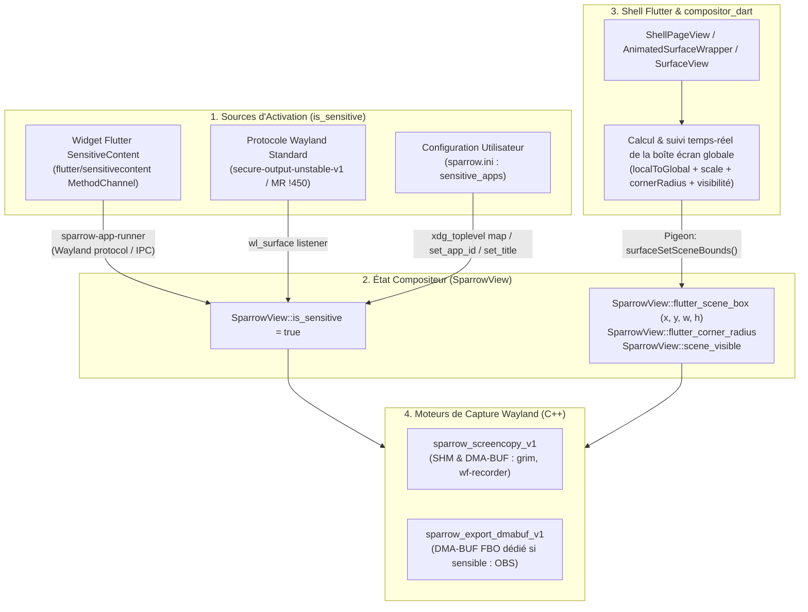

# SensitiveContent & Secure Output Architecture in Sparrow

## 1. Objectif & Vision

L'objectif de **SensitiveContent** dans Sparrow est de fournir une protection de bout en bout contre la capture d'écran et l'enregistrement vidéo des fenêtres contenant des données sensibles (gestionnaires de mots de passe, authentification, clés privées, applications bancaires, ou widgets Flutter utilisant `SensitiveContent`), sur le modèle de :
- **Android** (`FLAG_SECURE` / widget Flutter `SensitiveContent` sur le canal `flutter/sensitivecontent`)
- **Windows** (`SetWindowDisplayAffinity` avec `WDA_EXCLUDEFROMCAPTURE`)
- **niri** (`block-out-from` : commit `493c8dc89072a746795d4e7b94363cfef3e0ee89`)
- **KDE KWin** (MR `!8442` — exclusion de fenêtres des screencasts)
- **Wayland Protocols** ([MR !450](https://gitlab.freedesktop.org/wayland/wayland-protocols/-/merge_requests/450), [Issue #95](https://gitlab.freedesktop.org/wayland/wayland-protocols/-/work_items/95), et Chromium [`secure-output-unstable-v1.xml`](https://chromium.googlesource.com/chromium/src/+/main/third_party/wayland-protocols/unstable/secure-output/secure-output-unstable-v1.xml))

### Comportement attendu
1. **Sur l'écran physique (`wlr_output`)** : l'utilisateur voit l'application normalement, sans aucune altération visuelle ni perte de performance (Direct Scanout / 1-Pass Blit préservé).
2. **Dans les captures d'écran et flux vidéo (`grim`, `wf-recorder`, `wdisplays`, OBS, PipeWire / `xdg-desktop-portal-wlr`)** :
   - Seule la surface de l'application sensible est remplacée par un **rectangle noir opaque (`#000000FF`)** aux dimensions, coordonnées et coins arrondis exacts de la fenêtre.
   - Le reste du bureau (fond d'écran, autres fenêtres non sensibles, barre des tâches Flutter) reste parfaitement visible dans la capture.
3. **Support complet des modes du Shell Flutter** :
   - **Mode Normal (`fraction == 1.0`)** : la fenêtre sensible active est masquée en noir (plein écran ou centrée/letterboxée). Si la fenêtre sensible est sur une autre page du `PageView` (hors écran), elle ne masque **pas** la page courante.
   - **Mode Overview (`fraction == 0.5`) & Transitions** : la carte miniature de la fenêtre sensible dans le carrousel est masquée en noir à sa position exacte, à l'échelle `0.5`, **avec ses coins arrondis (`ClipRRect`, rayon jusqu'à `24px`)**.
   - **Multi-applications sensibles** : si plusieurs fenêtres sensibles sont visibles simultanément (ex. côte à côte dans l'Overview ou sur plusieurs moniteurs), chacune est individuellement masquée en noir.

---

## 2. Diagnostic des 2 Essais Précédents (`stash@{35}` & `stash@{37}`)

Deux prototypes avaient été réalisés dans `stash@{35}` (`secure_screencopy`) et `stash@{37}` (`secure_content_screencopy_and_export_dmabuf`). Leur analyse révèle **4 causes racines** expliquant pourquoi ils n'étaient pas concluants :

### 2.1. `sparrow_view_get_scene_box()` retournait toujours `false`
Dans `src/surface/view.cpp`, la fonction `sparrow_view_get_scene_box()` cherchait une couche `sceneLayerPlatform` (`kFlutterLayerContentTypePlatformView`) dans `sparrow_renderer.current_scene.layers`.
Or, `compositor_dart` affiche les surfaces Wayland via le widget Flutter `Texture(textureId: surface.textureId)` (dans `MainSurface`), qui est rastérisé par Impeller/Skia **directement à l'intérieur du BackingStore FBO de Flutter (`sceneLayerTexture`)**.
- Il n'y a donc **aucune** couche `sceneLayerPlatform` dans `current_scene.layers`.
- `sparrow_view_get_scene_box()` échouait systématiquement (`return false`).
- Le code de secours dans `sparrow_get_sensitive_view_buffer_box()` utilisait alors `(view->x, view->y, view->width, view->height)` qui vaut `(0, 0, 1920, 1080)` pour toutes les fenêtres mappées.

### 2.2. Fenêtres hors-écran (autres pages du `PageView`) considérées comme visibles
Comme le fallback utilisait `(view->x, view->y, view->width, view->height)` sur toutes les vues de `instance->views_list` dès que `surface->mapped` était vrai :
- Une application sensible ouverte sur la **Page 2** (totalement invisible lorsque l'utilisateur regarde la **Page 1**) provoquait quand même un écran noir complet lors d'une capture de la Page 1 !

### 2.3. Absence de synchronisation de la géométrie globale et des coins arrondis en mode Overview
Dans `compositor_dart/lib/src/presentation/surface.dart`, `cubit.updatePosition(posX, posY)` n'était appelé que lorsque `interactive == true` (donc **jamais** en mode Overview où `interactive` vaut `false`), et `posX, posY` ne représentait que le décalage local de letterbox, sans tenir compte :
- Du décalage horizontal de défilement du `PageView`,
- Du facteur d'échelle `fraction` (`0.5` en mode Overview),
- Du rayon de courbure `radius` (`ClipRRect` de `RoundedSurface` dans `animated_surface_wrapper.dart`).

### 2.4. Annulation brute des frames `wlr-export-dmabuf-unstable-v1`
Dans `stash@{37}`, `sparrow_export_dmabuf.cpp` envoyait `zwlr_export_dmabuf_frame_v1_send_cancel` dès qu'une vue sensible était présente, car `export-dmabuf` exportait directement le FD du buffer primaire du moniteur physique (`event->state->buffer`). Cela figeait ou interrompait les flux OBS / PipeWire au lieu de diffuser le bureau avec la fenêtre sensible masquée en noir.

---

## 3. Architecture de la Solution



### 3.1. Les 3 Sources de Marquage `is_sensitive`

1. **Canal Flutter `flutter/sensitivecontent` dans `sparrow-app-runner`** :
   - Implémente `SensitiveContent.isSupported` (`true`), `SensitiveContent.setContentSensitivity` (`0 = autoSensitive`, `1 = sensitive`, `2 = notSensitive`) et `SensitiveContent.getContentSensitivity`.
   - Permet d'utiliser nativement le widget officiel Flutter `SensitiveContent` sous Linux dans n'importe quelle application exécutée par `sparrow-app-runner`.
   - Notifie le compositeur via le protocole Wayland `zcr_secure_output_v1` (et en fallback via `sparrow-ipc-v1` `setSurfaceSensitive` avec correspondance par `wl_client` PID / `app_id`).

2. **Protocole Wayland `secure-output-unstable-v1` (`zcr_secure_output_v1`)** :
   - Protocole supporté par Chromium/Exo (`proto/secure-output-unstable-v1.xml`) permettant à un client de créer un objet `zcr_security_v1` pour une `wl_surface` et d'appeler `only_visible_on_secure_output()`.
   - Dès que la surface (ou l'une de ses sous-surfaces) est marquée avec cette sécurité, `SparrowView::is_sensitive` passe à `true`. (Le protocole en amont MR !450 `ext_sensitive_content_v1` suit le même principe).

3. **Auto-détection par règles (`sparrow.ini` & `Core::is_app_sensitive`)** :
   - Lors de `xdg_toplevel_map`, `xdg_toplevel_set_app_id` et `xdg_toplevel_set_title`, Sparrow vérifie si l'`app_id` ou le `title` correspond à la liste `sensitive_app_ids` (ex. `KeePassXC`, `Bitwarden`, `1Password`, plus toute entrée configurée dans `sparrow.ini`).

---

### 3.2. Synchronisation Précise de la Géométrie Flutter (`flutter_scene_box` & `flutter_corner_radius`)

Pour que le compositeur C++ connaisse à chaque frame la position exacte, la taille affichée, le rayon des coins arrondis et la visibilité réelle de chaque `SurfaceView` (en mode Normal, en mode Overview `0.5`, et pendant les glissements du `PageView`) :

1. **Côté Dart (`compositor_dart` + `shell` + Pigeon)** :
   - Ajout dans `CompositorHostApi` (Pigeon) de :
     ```dart
     @async
     void surfaceSetSceneBounds(
       int surfaceHandle,
       int x,
       int y,
       int width,
       int height,
       double cornerRadius,
       bool visible,
     );
     ```
   - Dans `SurfaceView` / `MeasureSizeRenderObject` (et lors des animations de `PageController` / `overviewController` dans `AnimatedSurfaceWrapper`) :
     - Calcul de la boîte englobante globale à l'écran via `RenderBox.localToGlobal` (qui intègre automatiquement le scroll du `PageView`, le `scale` de l'Overview, le `gap` et le letterboxing).
     - Vérification de l'intersection avec l'écran `(0, 0, output.width, output.height)` : si la page est hors-écran (ex. Page 2 quand la Page 1 est affichée) ou démontée (`dispose`), `visible = false` est envoyé au C++.
     - Transmission du rayon de courbure effectif (`0.0` en mode Normal, jusqu'à `24.0 * scale` en mode Overview).

2. **Côté C++ (`SparrowView` & `sparrow_get_sensitive_view_buffer_box`)** :
   - `SparrowView` stocke :
     - `bool scene_visible`
     - `bool has_flutter_scene_box`
     - `struct wlr_box flutter_scene_box`
     - `double flutter_corner_radius`
   - `sparrow_view_get_scene_box()` retourne désormais `view->flutter_scene_box` si `view->has_flutter_scene_box && view->scene_visible` (et `false` si `!view->scene_visible`).
   - `sparrow_get_sensitive_view_buffer_box()` convertit cette boîte logique en coordonnées physiques du buffer d'output (en tenant compte de `output->transform` et `output->scale`) ainsi que le rayon `corner_radius_px = lround(view->flutter_corner_radius * output->scale)`.

---

### 3.3. Censure Matérielle et Logicielle avec Support des Coins Arrondis

1. **`sparrow_screencopy_v1` (`src/screencopy/sparrow_screencopy.cpp`)** :
   - **Chemin SHM (`frame_shm_copy` -> `censor_shm_pixels`)** :
     - Copie les pixels du buffer de sortie dans le buffer SHM du client.
     - Pour chaque `SparrowView` sensible visible sur cet output, remplit l'intersection avec des pixels noirs opaques (`0xFF000000` / `0x000000FF` selon le format DRM).
     - Si `corner_radius_px > 0` (mode Overview), applique l'inset elliptique ligne par ligne (`ellipse_inset`) sur les coins supérieurs et inférieurs pour épouser parfaitement le `ClipRRect` de Flutter.
   - **Chemin DMA-BUF (`frame_dma_copy` -> `censor_dma_pass`)** :
     - Ouvre une `wlr_render_pass` sur le `frame->buffer` du client et y copie la texture de l'output.
     - Pour chaque `SparrowView` sensible visible, construit une `pixman_region32_t` (rectangulaire ou arrondie via `pixman_region32_init_rounded_rect` si `corner_radius_px > 0`) et dessine un rectangle noir opaque via `wlr_render_pass_add_rect` clippé par cette région.

2. **`sparrow_export_dmabuf_v1` (`src/export_dmabuf/sparrow_export_dmabuf.cpp`)** :
   - **Si aucune vue sensible n'est visible sur l'output** : exporte directement les FD DMA-BUF de `event->state->buffer` (zéro copie).
   - **Si au moins une vue sensible est visible sur l'output** :
     - Alloue un `wlr_buffer` DMA-BUF dédié via `wlr_allocator_create_buffer(output->allocator, ...)` (mis en cache ou alloué pour la frame),
     - Exécute une `wlr_render_pass` qui copie `event->state->buffer` puis applique `censor_dma_pass` (rectangles noirs avec coins arrondis éventuels),
     - Exporte les FD DMA-BUF de ce buffer censuré au client (OBS / PipeWire) sans jamais bloquer le flux ni toucher au buffer affiché sur le moniteur physique !

---

## 4. Plan d'Implémentation Étape par Étape

### Étape 1 : Protocoles Wayland & Build (`proto/`)
- Ajouter `proto/wlr-screencopy-unstable-v1.xml`, `proto/wlr-export-dmabuf-unstable-v1.xml` et `proto/secure-output-unstable-v1.xml` (ainsi que le support du protocole sensitive-content).
- Enregistrer ces protocoles dans `proto/meson.build` (serveur et client).

### Étape 2 : Modèle `SparrowView`, Auto-détection & Protocole Serveur (`src/surface/`, `src/core.*`, `src/ipc/`)
- Ajouter `is_sensitive`, `scene_visible`, `has_flutter_scene_box`, `flutter_scene_box`, et `flutter_corner_radius` dans `SparrowView` (`src/surface/view.hpp`).
- Implémenter le global Wayland `zcr_secure_output_v1` pour que tout client Wayland natif (et `sparrow-app-runner`) puisse marquer sa `wl_surface` comme sensible.
- Ajouter `is_app_sensitive()` dans `Core` et le brancher sur `xdg_toplevel_map`, `xdg_toplevel_set_app_id`, et `xdg_toplevel_set_title` dans `src/surface/surface.cpp`, ainsi que la lecture depuis `sparrow.ini`.
- Ajouter la méthode IPC `setSurfaceSensitive` dans `src/ipc/ipc_server.cpp`.

### Étape 3 : Pigeon & Synchronisation Géométrique Temps-Réel (`platform/pigeon/`, `compositor_dart/`, `shell/`)
- Ajouter `surfaceSetSceneBounds(int surfaceHandle, int x, int y, int width, int height, double cornerRadius, bool visible)` dans `platform/pigeon/compositor/pigeon_compositor/pigeons/messages.dart` et régénérer Pigeon (`./build.sh pigeon`).
- Mettre à jour `compositor_dart` (`CompositorPlatformApi`, `SurfaceView`, `MeasureSizeRenderObject`) et `shell` (`AnimatedSurfaceWrapper`, `SurfacePage`) pour calculer et remonter la boîte globale écran `(x, y, width, height)`, le `cornerRadius` et la visibilité réelle (`visible`) lors du layout, du défilement `PageView` et des transitions Overview.
- Mettre à jour `sparrow_view_get_scene_box()` dans `src/surface/view.cpp` et `sparrow_get_sensitive_view_buffer_box()` dans `src/core.cpp`.

### Étape 4 : Moteurs de Capture Censurés (`src/screencopy/` & `src/export_dmabuf/`)
- Implémenter `src/screencopy/sparrow_screencopy.cpp` (.hpp) avec `censor_shm_pixels` (incluant l'inset elliptique des coins arrondis) et `censor_dma_pass` (incluant le clip `pixman_region32_init_rounded_rect`).
- Implémenter `src/export_dmabuf/sparrow_export_dmabuf.cpp` (.hpp) avec rendu dans un buffer DMA-BUF censuré lorsqu'une vue sensible est visible, évitant tout `send_cancel`.
- Remplacer `wlr_screencopy_manager_v1_create` et `wlr_export_dmabuf_manager_v1_create` dans `src/core.cpp`.

### Étape 5 : Support Client dans `sparrow-app-runner` (`src/runner/`)
- Implémenter le `MethodChannel` `flutter/sensitivecontent` (`StandardMethodCodec`) dans `src/runner/flutter_runner.cpp`.
- Connecter `SensitiveContent.setContentSensitivity` au protocole Wayland / IPC pour activer/désactiver `is_sensitive` dynamiquement.

### Étape 6 : Tests & Validation
- Vérifier les tests unitaires Dart (`compositor_dart` & `shell`) et l'analyse statique (`dart analyze`).
- Compiler le serveur et le client (`./build.sh debug`), vérifier le formatage C++ (`uncrustify`), et valider les captures SHM/DMA-BUF en mode Normal et Overview.

